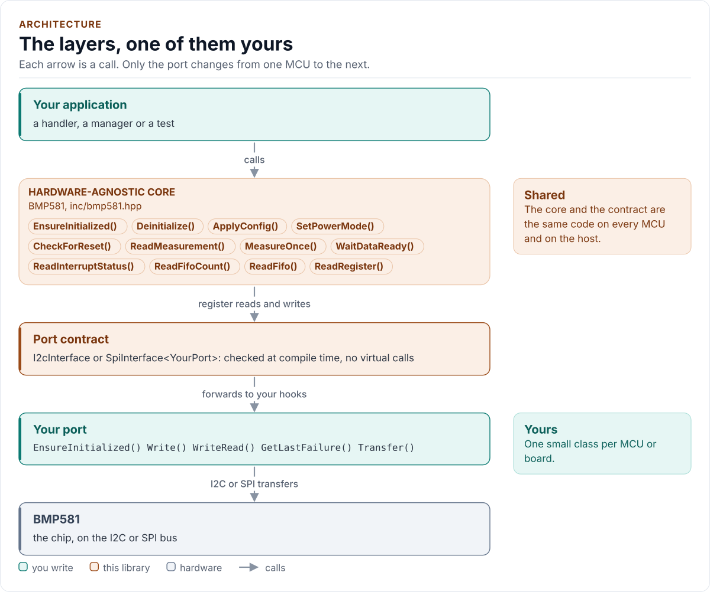

# BMP581 Driver

C++20 driver for the Bosch BMP581 barometric pressure and temperature sensor on I2C and SPI.

[](https://github.com/kokeb-labs-drivers/driver-bmp581/actions/workflows/ci.yml)
[](LICENSE)
[](docs/installation.md#requirements)

**Documentation: [`docs/`](docs/index.md)**, with the API reference built by Doxygen ([how](docs/api-reference.md)).
The site at <https://kokeb-labs-drivers.github.io/driver-bmp581/> opens when the repository is public.


The BMP581 measures absolute pressure from 30 kPa to 125 kPa in steps of 1/64 Pa, and temperature, and compensates
both on the chip. This driver starts it from a soft reset with the datasheet's checks, measures on request or
continuously, reads the FIFO, and never returns a stuck line, a reset value or an out-of-range reading as a
measurement. It finds a power-on reset mid-session and never writes its settings over a reset chip. It runs on any
MCU, on I2C or SPI: you give it a small class that moves bytes on your bus, and it does the rest.

<!-- figure: driver-layers -->
<picture>
  <source media="(prefers-color-scheme: dark)" srcset="docs/diagrams/driver-layers.dark.svg">
  
</picture>
<!-- /figure -->

## At a glance

| | |
| --- | --- |
| **Chip** | Bosch BMP581 barometric pressure sensor; VDD 1.71 V to 3.6 V, VDDIO 1.08 V to 3.6 V |
| **Measures** | Pressure 30 kPa to 125 kPa at 1/64 Pa; temperature -40 °C to 85 °C at 1/65536 °C |
| **Bus** | I2C up to 1 MHz at `0x46` or `0x47` (SDO), or four-wire SPI up to 12 MHz, mode 0 or 3 |
| **Features** | Forced, normal and continuous modes, oversampling, IIR filter, FIFO, interrupt sources, out-of-range |
| **Driver** | Header-only C++20; no heap, exceptions, RTTI or virtual calls; every call returns `Result<T>` |
| **Runs on** | Any MCU with I2C or SPI and a C++20 compiler; the host example runs on any PC ([Platforms](docs/platforms.md)) |
| **Status** | 0.1.0, not yet verified on hardware: host-tested against a register model of the chip |

## Datasheet

<!-- generated: datasheet-card -->
| Document | Revision | Get it |
| --- | --- | --- |
| Datasheet: BMP581 Barometric Pressure Sensor (Bosch Sensortec BST-BMP581-DS004-13) | 1.13, 2025-04 | [PDF](https://www.bosch-sensortec.com/media/boschsensortec/downloads/datasheets/bst-bmp581-ds004.pdf) · [vendor page](https://www.bosch-sensortec.com/products/environmental-sensors/pressure-sensors/bmp581/) |

Written against these revisions; the SHA-256 of each file is in [`docs/datasheets.yml`](docs/datasheets.yml). Where each
part of the driver is in the datasheet: [Datasheet map](docs/datasheet.md).
<!-- /generated -->

Every docs page lists the datasheet sections it relies on, and code comments cite the section they implement.

## Try it on your PC

No hardware needed: [`examples/host`](examples/host/README.md) runs the driver against a simulated chip.
You need git, CMake 3.16+ and a C++20 compiler (GCC 10+, Clang 13+ or MSVC 2022).

1. Get the source:

   ```bash
   git clone https://github.com/kokeb-labs-drivers/driver-bmp581.git && cd driver-bmp581
   ```

2. Build and run the example:

   ```bash
   cmake -S examples/host -B build-example
   cmake --build build-example
   ./build-example/bmp581_host_example
   ```

3. You should see the driver start the simulated chip, measure twice in forced mode and twice in normal mode:

   ```text
   BMP581 driver 0.1.0 on the host
   bmp581: initialised
   101325.000 Pa  21.5000 C
   101325.000 Pa  21.5000 C
   101325.000 Pa  21.5000 C
   101325.000 Pa  21.5000 C
   bmp581: deinitialised
   ```

To run the whole test suite instead: `cmake -S . -B build -DBMP581_BUILD_TESTS=ON && cmake --build build && ctest
--test-dir build`.

## Use it on your MCU

**1. Wire it** ([Hardware](docs/hardware.md) has every pin, the timing and the power):

| MCU | BMP581 pin | Notes |
| --- | --- | --- |
| I2C SCL | SCK (2) | Pull-up to VDDIO; 4.7 kΩ suits 100 kHz and 400 kHz |
| I2C SDA | SDI (4) | Pull-up to VDDIO |
| GND | SDO (5) | Address `0x46` (`i2c::kI2cAddress`); VDDIO gives `0x47`; never floating |
| I/O supply | CSB (6), VDDIO (1) | CSB tied to VDDIO selects I2C; 100 nF at VDDIO |
| 1.8 V to 3.3 V | VDD (10) | 100 nF to GND close to the pin |
| GND | VSS (3, 8, 9) | INT (7) to GND when unused |

On SPI: SCK, SDI (MOSI), SDO (MISO) and CSB to the MCU's SPI pins ([Hardware](docs/hardware.md#spi)).

**2. Write the port**: a class with `EnsureInitialized()` (bring the bus up), `Write()` and `WriteRead()` (one I2C
transaction each), or `Transfer()` (one SPI frame), and `DelayUs()`, about 20 lines on most SDKs.
[Porting](docs/porting.md) has the contract and complete examples for both buses.

**3. Take a measurement:**

<!-- generated: quickstart-code -->
```cpp
#include "bmp581.hpp"

int read_pressure(MyPort& port, float& pascals, float& celsius) {
  bmp581::BMP581<MyPort> sensor(port, bmp581::ForcedPreset()); // no I/O yet

  if (auto r = sensor.EnsureInitialized(); !r) { // 1. soft reset, CHIP_ID, NVM ready, Config
    return static_cast<int>(r.error); //    NoDevice, Bus or DeviceIdMismatch: check wiring
  }
  const auto m = sensor.MeasureOnce(); // 2. one forced measurement, then standby
  if (!m) {
    return static_cast<int>(m.error); //    every failure is an Error, never a number
  }
  pascals = bmp581::PressurePa(m.value.pressure_raw);      // 3. 1/64 Pa, exact
  celsius = bmp581::TemperatureC(m.value.temperature_raw); //    1/65536 °C, exact
  return 0;
}
```
<!-- /generated -->

`EnsureInitialized()` is the only call that starts the chip. Every other call returns `Error::NotInitialized`
until it has succeeded, and no read ever starts the chip on its own.

## What it does

- Brings the chip up with a soft reset and the datasheet's post-power-up checks (CHIP_ID, NVM ready, the reset
  flag); nothing else touches the chip before that succeeds.
- Writes the configuration in standby, one register per transfer, and reads all of it back.
- Measures on request (forced mode, a bounded wait) or streams in normal or continuous mode with data ready; reads
  the FIFO with a validity per frame.
- Reads each measurement in one burst and refuses a stuck or floating line, the reset value and anything outside
  the measurement range; converts exactly to pascals and degrees Celsius.
- Finds a power-on reset by INT_STATUS and by OSR_CONFIG, confirms it with a second read, and never writes over it.
- Returns `Result<T>` with an `Error` from every call: no exceptions, no heap, no RTTI, no virtual calls.

## Add it to your project

Pick the row that matches your build; each is a few steps, and [Installation](docs/installation.md) has the
details.

| Your build | Steps below |
| --- | --- |
| Plain CMake: STM32 (CubeMX), RP2040 (Pico SDK), nRF Connect, a host app | [A](#a-cmake-any-mcu) |
| ESP-IDF | [B](#b-esp-idf) |
| An SDK or OS image that installs libraries | [C](#c-installed-package) |

### A. CMake, any MCU

1. Add the driver as a submodule, pinned to the version you chose:

   ```bash
   git submodule add https://github.com/kokeb-labs-drivers/driver-bmp581.git external/driver-bmp581
   ```

2. In your `CMakeLists.txt`, after `project()`:

   ```cmake
   add_subdirectory(external/driver-bmp581)
   target_link_libraries(my_app PRIVATE bmp581::bmp581)   # brings the headers and C++20
   ```

3. In your code, `#include "bmp581.hpp"`, write the port ([Porting](docs/porting.md)) and build. A first build
   that compiles the quickstart above is the check that the driver is wired in.

### B. ESP-IDF

1. Add the driver under your project's `components/`; ESP-IDF finds it there and names it after the folder:

   ```bash
   git submodule add https://github.com/kokeb-labs-drivers/driver-bmp581.git components/bmp581
   ```

2. In `main/CMakeLists.txt`, list it: `idf_component_register(SRCS "main.cpp" REQUIRES bmp581)`.
3. `idf.py menuconfig` now has a **BMP581 pressure sensor** menu (oversampling, data ready, timeouts),
   and `idf.py build` builds the driver with your app. [`examples/esp32`](examples/esp32) is a complete
   project with a port for the board.

### C. Installed package

1. Install it once into a prefix:

   ```bash
   cmake -S external/driver-bmp581 -B build-bmp581 && cmake --install build-bmp581 --prefix /opt/sdk
   ```

2. In your project, with `CMAKE_PREFIX_PATH=/opt/sdk`:

   ```cmake
   find_package(bmp581 0.1 REQUIRED)
   target_link_libraries(my_app PRIVATE bmp581::bmp581)
   ```

The target is `bmp581::bmp581` every way, so switching later changes nothing else.

## Documentation

| Page | Read it when you want to |
| --- | --- |
| [Quickstart](docs/quickstart.md) | Go from a bare chip to a measurement on your MCU |
| [Hardware](docs/hardware.md) | Wire it, check the bus settings, the timing and the power |
| [Porting](docs/porting.md) | Write the port class for your MCU's SDK |
| [API guide](docs/api-guide.md) | Use each call: start, measure, stream, read the FIFO, handle resets and errors |
| [Configuration](docs/configuration.md) | Choose every setting, or start from a preset |
| [Troubleshooting](docs/troubleshooting.md) | Find the cause of an error or a wrong reading |
| [Contract](docs/contract.md) | Know exactly what the driver promises, needs and returns |
| [Datasheet map](docs/datasheet.md) | Find the datasheet section behind each part of the driver |
| [API reference](docs/api-reference.md) | Look up a class or member (Doxygen; built by CI and locally) |

## Tests and quality

```bash
cmake -S . -B build -DBMP581_BUILD_TESTS=ON && cmake --build build && ctest --test-dir build
```

The host tests run the driver on I2C and SPI against a register model of the chip that measures and resets on its
own, fail every bus transfer in turn, and produce each error the driver can return. A fuzzer fails, corrupts and
replaces what the chip sends back, resets the chip at any point, and checks after every call that no broken line
is returned as data and no reset is missed. CI also builds for Cortex-M and gates coverage, complexity, sanitizers,
fuzzing, clang-tidy, cppcheck and the handbook rules (`.kokeb/handbook.yml`). See [Testing and CI](docs/testing.md),
which lists every gate and its limit.

## License

MIT. See [LICENSE](LICENSE).
