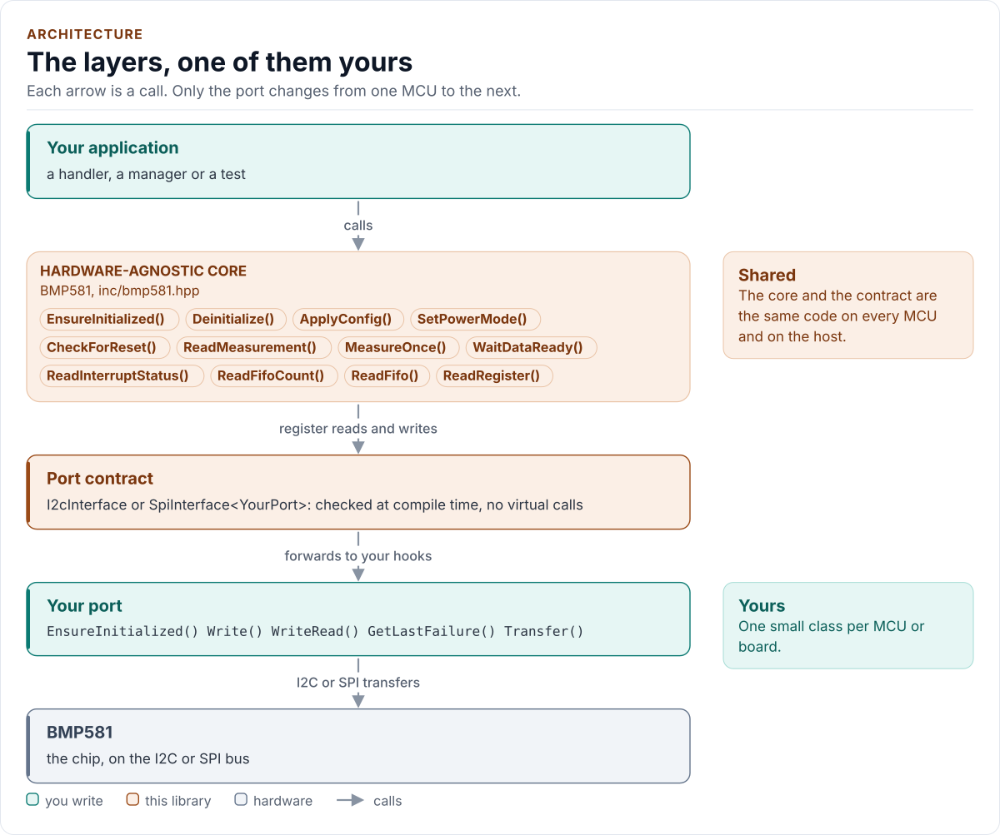
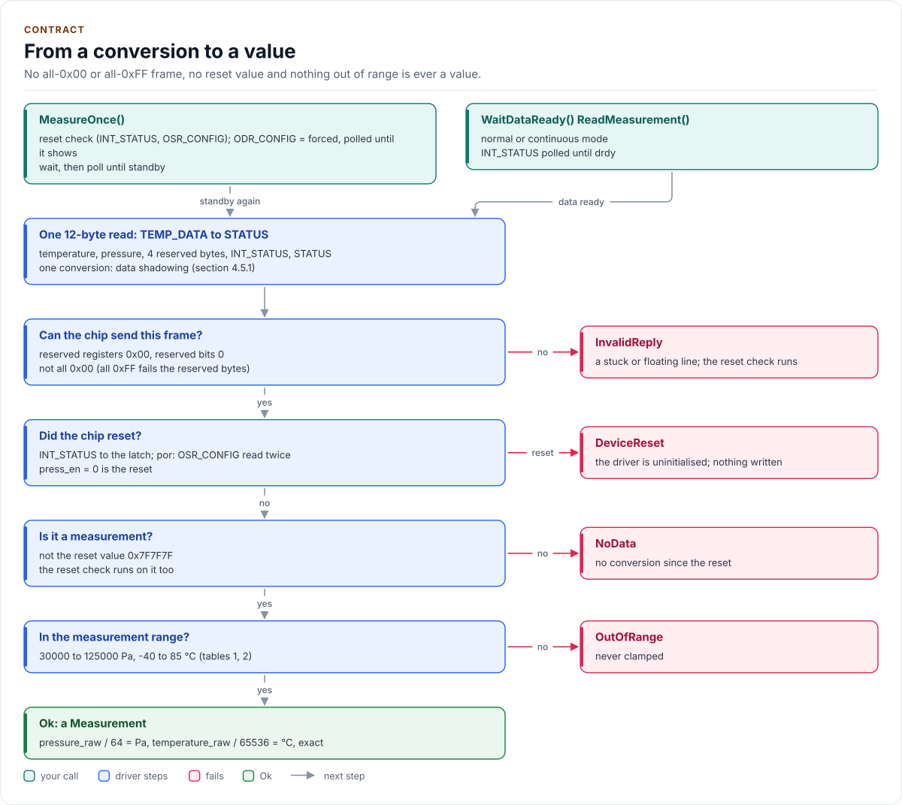
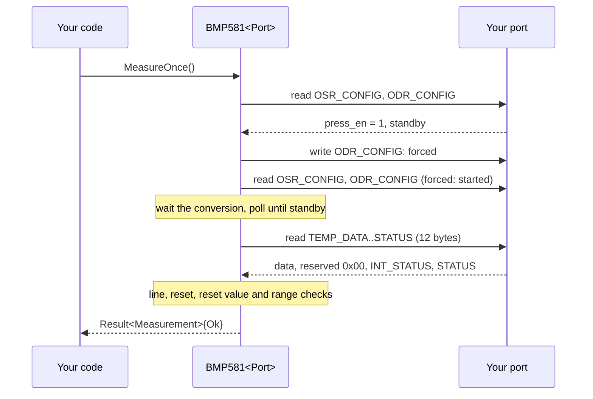
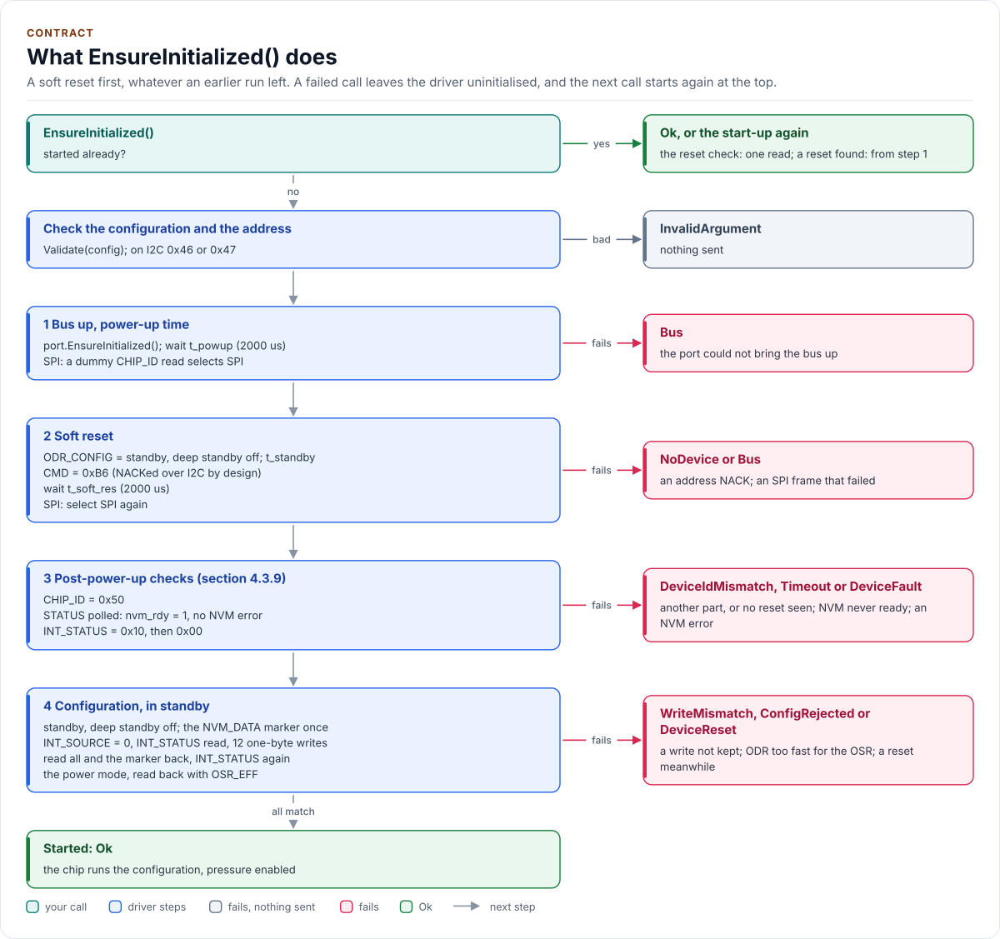

# Architecture

How the driver is built: three layers, one of them yours, and what happens in each when you take a measurement.

<!-- generated: datasheet-refs -->
??? abstract "Datasheet sections this page relies on"

    From Bosch Sensortec BST-BMP581-DS004-13 1.13:

    - Supplies, timing and conversion times: 2 Specification; Table 4 Electrical characteristics, [p. 10](https://www.bosch-sensortec.com/media/boschsensortec/downloads/datasheets/bst-bmp581-ds004.pdf#page=10)
    - Register writes only in standby: 4.3.8 Mode-depending register write restrictions, [p. 18](https://www.bosch-sensortec.com/media/boschsensortec/downloads/datasheets/bst-bmp581-ds004.pdf#page=18)
    - Post-power-up checks: 4.3.9 Post-power-up procedure, [p. 18](https://www.bosch-sensortec.com/media/boschsensortec/downloads/datasheets/bst-bmp581-ds004.pdf#page=18)
    - Soft reset: 4.3.10 Soft reset; 7.36 Register (0x7E) Command Register, [p. 18](https://www.bosch-sensortec.com/media/boschsensortec/downloads/datasheets/bst-bmp581-ds004.pdf#page=18)
    - Data registers and data shadowing: 4.5 Data registers; 4.5.1 Data Shadowing, [p. 22](https://www.bosch-sensortec.com/media/boschsensortec/downloads/datasheets/bst-bmp581-ds004.pdf#page=22)
    - Read burst address increment: 5.4 Read burst address increment, [p. 36](https://www.bosch-sensortec.com/media/boschsensortec/downloads/datasheets/bst-bmp581-ds004.pdf#page=36)

    All of them, with the driver API for each: [Datasheet map](datasheet.md).
<!-- /generated -->

<!-- figure: driver-layers -->
<picture>
  <source media="(prefers-color-scheme: dark)" srcset="diagrams/driver-layers.dark.svg">
  
</picture>
<!-- /figure -->

## Layers

| Layer | Files | Owns |
| --- | --- | --- |
| Core | [`inc/bmp581.hpp`](../inc/bmp581.hpp), [`src/bmp581.ipp`](../src/bmp581.ipp) | Lifecycle, configuration, power modes, measurements, the FIFO, the reset check, errors |
| Types and registers | [`inc/bmp581_types.hpp`](../inc/bmp581_types.hpp), [`inc/bmp581_registers.hpp`](../inc/bmp581_registers.hpp) | `Error`, `Result<T>`, `Config` and presets, timing and range constants, the conversions; the register map |
| Port contracts | [`inc/bmp581_i2c_interface.hpp`](../inc/bmp581_i2c_interface.hpp), [`inc/bmp581_spi_interface.hpp`](../inc/bmp581_spi_interface.hpp) | Each bus's CRTP base, its concept (`I2cPort`, `SpiPort`), its bus requirements and its register framing |
| Platform port | Your class | Bus bring-up and byte transfers, delays, optionally the failure reason (I2C) and logging |
| Kconfig layer | [`inc/bmp581_kconfig.hpp`](../inc/bmp581_kconfig.hpp) | Optional: a `Config` from ESP-IDF menuconfig |

## Two buses, one driver

The register model is the same on both buses; only the framing differs (sections 5.5, 5.6):

| | I2C | SPI |
| --- | --- | --- |
| Read | `WriteRead()`: the address, then the data | One frame: address with bit 7 set, then the data |
| Write | `Write()`: address and one data byte | One frame: address with bit 7 clear, one data byte |
| Start-up | Nothing extra | A dummy read selects SPI, again after each soft reset (section 5.1) |
| Soft reset | NACKed by the chip, expected (section 7.36) | A normal frame |
| Address NACK | `NoDevice` with `GetLastFailure()` | No ACK on SPI: an absent chip reads as a stuck line |

`BMP581<Port>` takes either: the `BusPort` concept accepts a class that is exactly one of `I2cPort` and `SpiPort`,
and `detail::BusFor<Port>` picks `I2cRegisterBus` or `SpiRegisterBus` at compile time. Both framings expose the
same four operations (select the interface, read a burst, write one register, write the reset command), so the core
has no bus-specific code. Every write is one register in one transfer: the chip stores it whole or not at all, and
SPI would need an address per byte in a burst anyway (figure 9).

## One measurement through the layers

<!-- figure: measurement -->
<picture>
  <source media="(prefers-color-scheme: dark)" srcset="diagrams/measurement.dark.svg">
  
</picture>
<!-- /figure -->

## Start-up

<!-- figure: start-up -->
<picture>
  <source media="(prefers-color-scheme: dark)" srcset="diagrams/start-up.dark.svg">
  
</picture>
<!-- /figure -->

## Design choices

- **CRTP, not virtual functions.** The port is a template parameter constrained by a concept, so every call is
  resolved at compile time and a missing hook is a compile error that names it.
- **Optional hooks by named concepts.** `DelayUs`, `GetLastFailure` and `Log` are detected by `Declares*` and
  `Has*` concepts in `bmp581::detail`. A missing `DelayUs()` fails to compile, a missing `GetLastFailure()` reports
  every failure as `Bus`, a missing `Log()` logs nothing; a misdeclared hook is a compile error.
- **No I/O in the constructor.** Construction cannot fail, so the driver can be a static or a member of a handler.
- **One error type.** `Result<T>` carries a value and an `Error`; nothing throws and nothing returns a bare `bool`.
- **One read buffer, owned by the driver.** Every read lands in the driver object's 96-byte buffer, and the SPI
  framing keeps its frames in the framing object, so the bus and its DMA never see a caller's stack. A value is
  copied out of the buffer before any later read (the reset check) reuses it.
- **No heap, no exceptions, no RTTI, no `std::function`, no `printf`.** The driver is a header-only template with
  no mutable static state.

## Source map

| You want | Read |
| --- | --- |
| The public API | [`inc/bmp581.hpp`](../inc/bmp581.hpp) |
| How a call is implemented | [`src/bmp581.ipp`](../src/bmp581.ipp) |
| Register addresses and bits | [`inc/bmp581_registers.hpp`](../inc/bmp581_registers.hpp) |
| The port contracts | [`inc/bmp581_i2c_interface.hpp`](../inc/bmp581_i2c_interface.hpp), [`inc/bmp581_spi_interface.hpp`](../inc/bmp581_spi_interface.hpp) |

Next: [Contract](contract.md).
