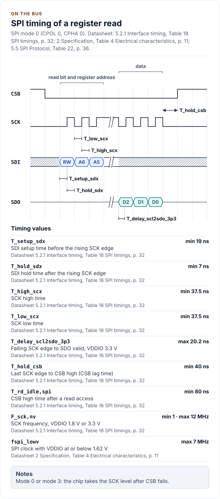
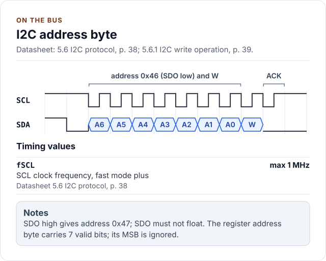
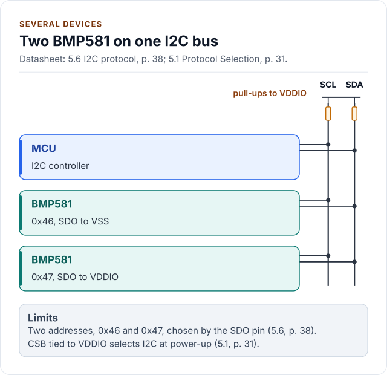

# On the bus

What the BMP581 needs from the bus, signal by signal, with every time and rate taken from the datasheet. The
connections are on the [Hardware](hardware.md) page; this page is the waveform under them. The chip selects its
interface at power-up: CSB held at VDDIO keeps I2C, and the first SPI frame switches it to SPI (section 5.1).

## SPI timing

The BMP581 latches SDI on the rising edge of SCK and changes SDO on the falling edge. It accepts mode 0 and mode 3
and tells them apart by the SCK level after CSB falls; the driver uses mode 0 (`spi::kSpiMode`). The first byte holds
the read bit and the 7-bit register address, then the data follow while CSB stays low (section 5.5).

<!-- figure: spi-timing -->
<picture>
  <source media="(prefers-color-scheme: dark)" srcset="diagrams/spi-timing.dark.svg">
  
</picture>
<!-- /figure -->

## I2C timing

The BMP581 runs at standard, fast and fast mode plus, up to 1 MHz (section 5.6). The datasheet gives no I2C timing
table of its own: section 5.2.2 refers to the NXP I2C-bus specification for every interval, so the figure draws the
address byte and the limit the datasheet states.

<!-- figure: i2c-timing -->
<picture>
  <source media="(prefers-color-scheme: dark)" srcset="diagrams/i2c-timing.dark.svg">
  
</picture>
<!-- /figure -->

## Several devices

SDO sets the last bit of the I2C address, so two BMP581 share one bus: one with SDO at VSS (`0x46`,
`i2c::kI2cAddress`) and one with SDO at VDDIO (`0x47`, `i2c::kI2cAddressSdoHigh`). SDO must never float on I2C. On
SPI, each BMP581 needs its own CSB.

<!-- figure: i2c-topology -->
<picture>
  <source media="(prefers-color-scheme: dark)" srcset="diagrams/i2c-topology.dark.svg">
  
</picture>
<!-- /figure -->

## How these figures are made

Each figure is a model in `docs/model/` (`spi-timing.timing.yml`, `i2c-timing.timing.yml` and
`i2c-topology.topology.yml`) that cites the datasheet section and page of every number; `kokeb-docs figures` draws
it and the build fails on a number without a citation. The values table under each waveform is also written as
`docs/diagrams/<id>.table.html`.
