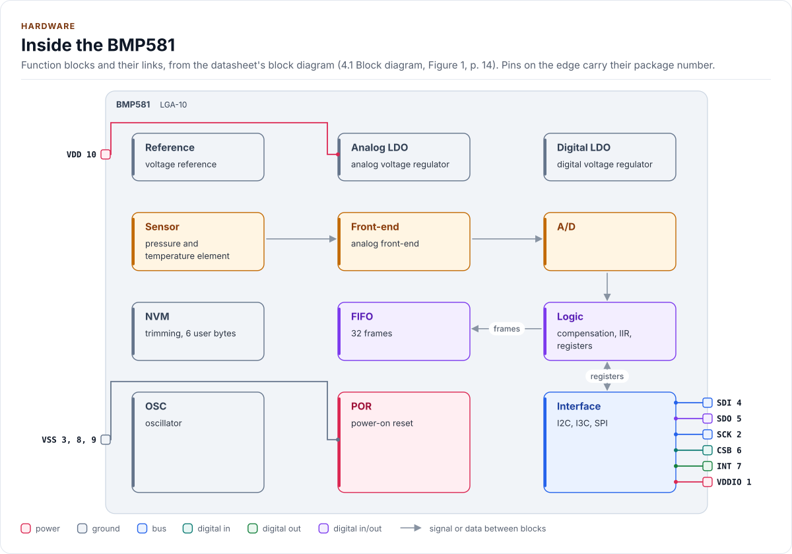
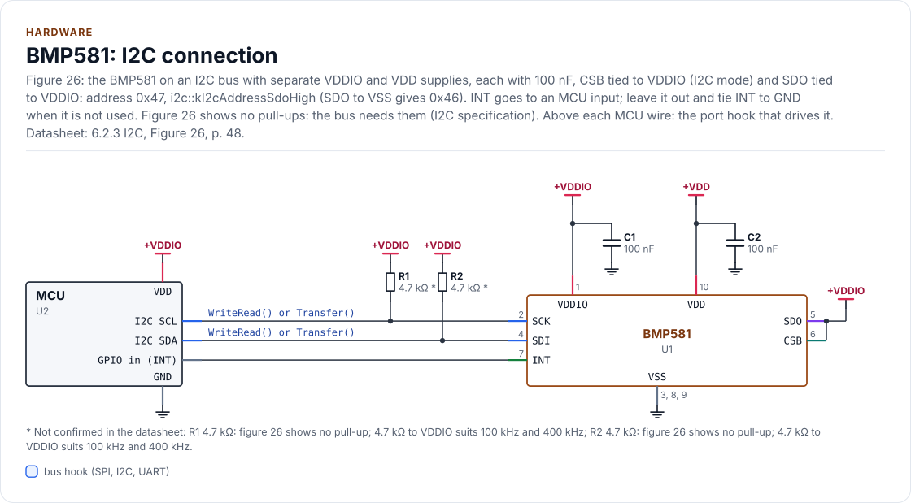
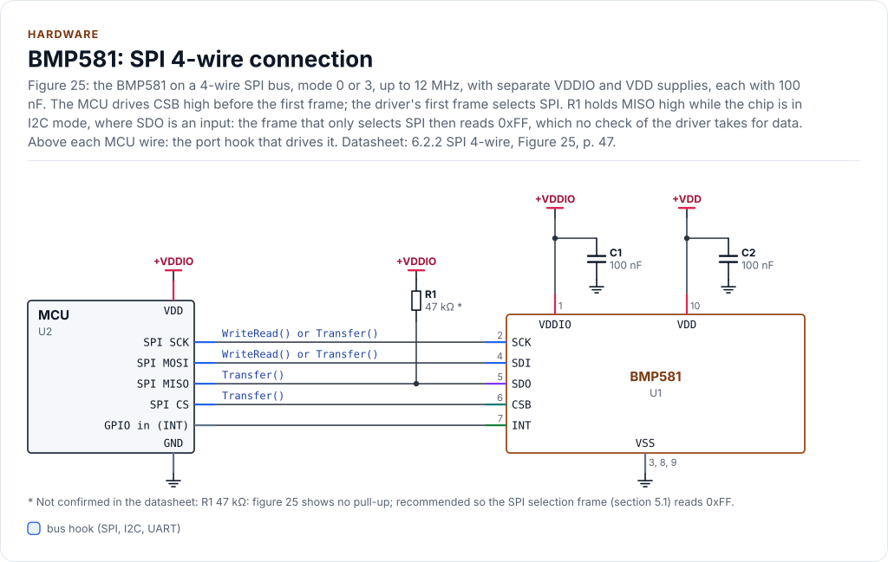
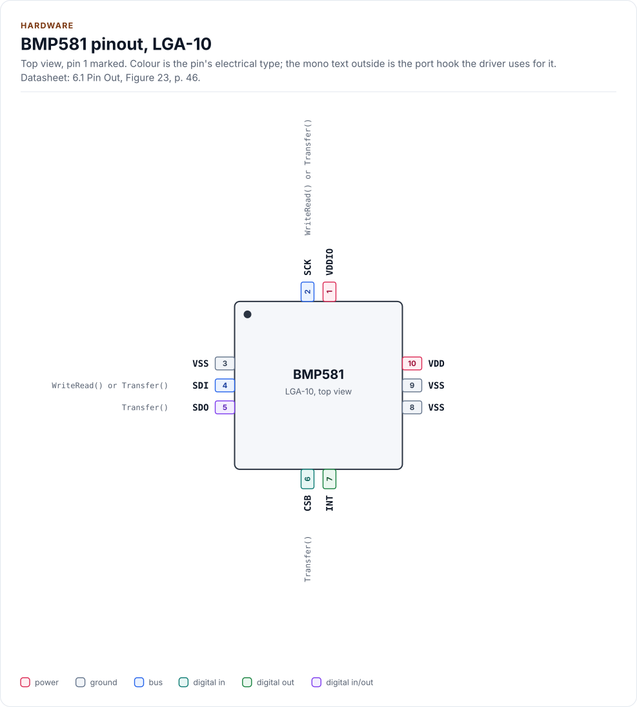
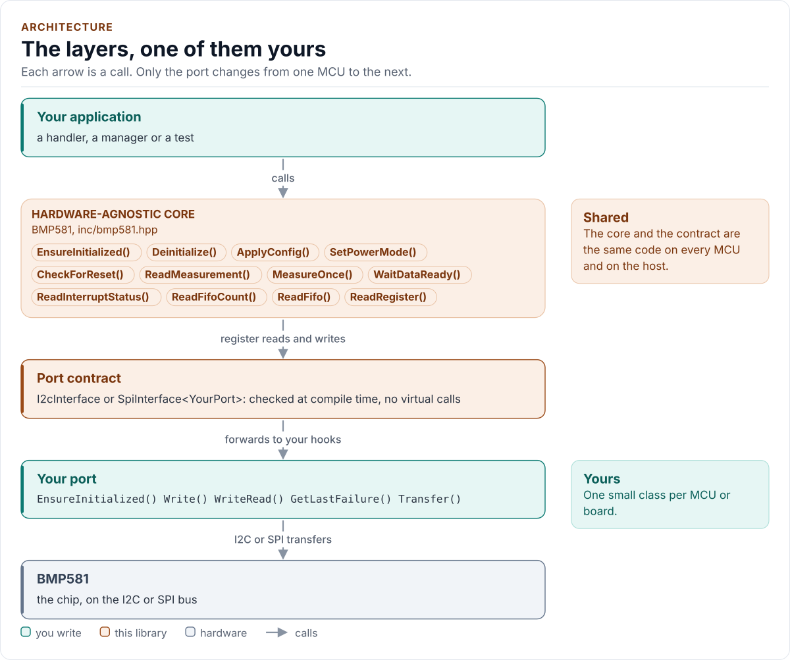
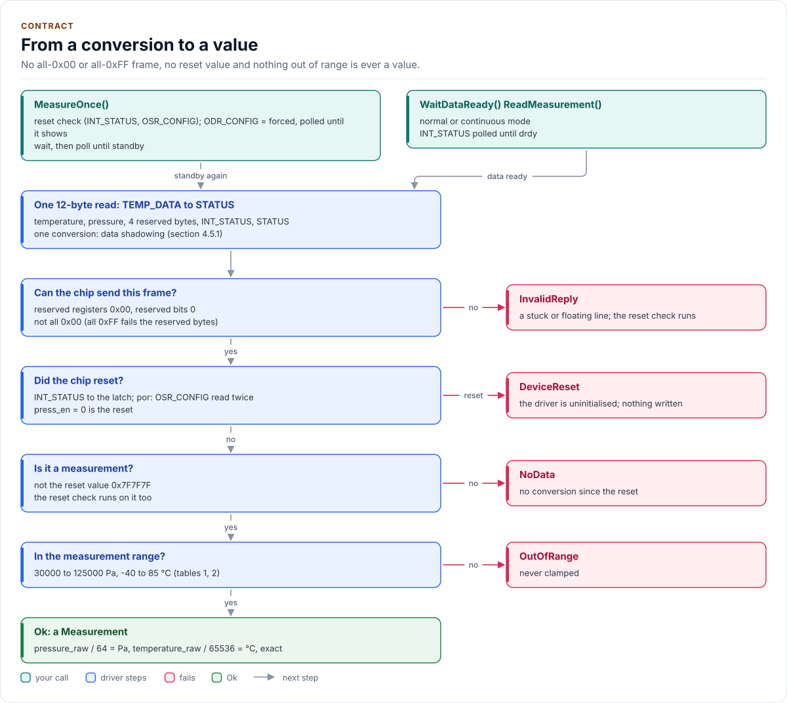
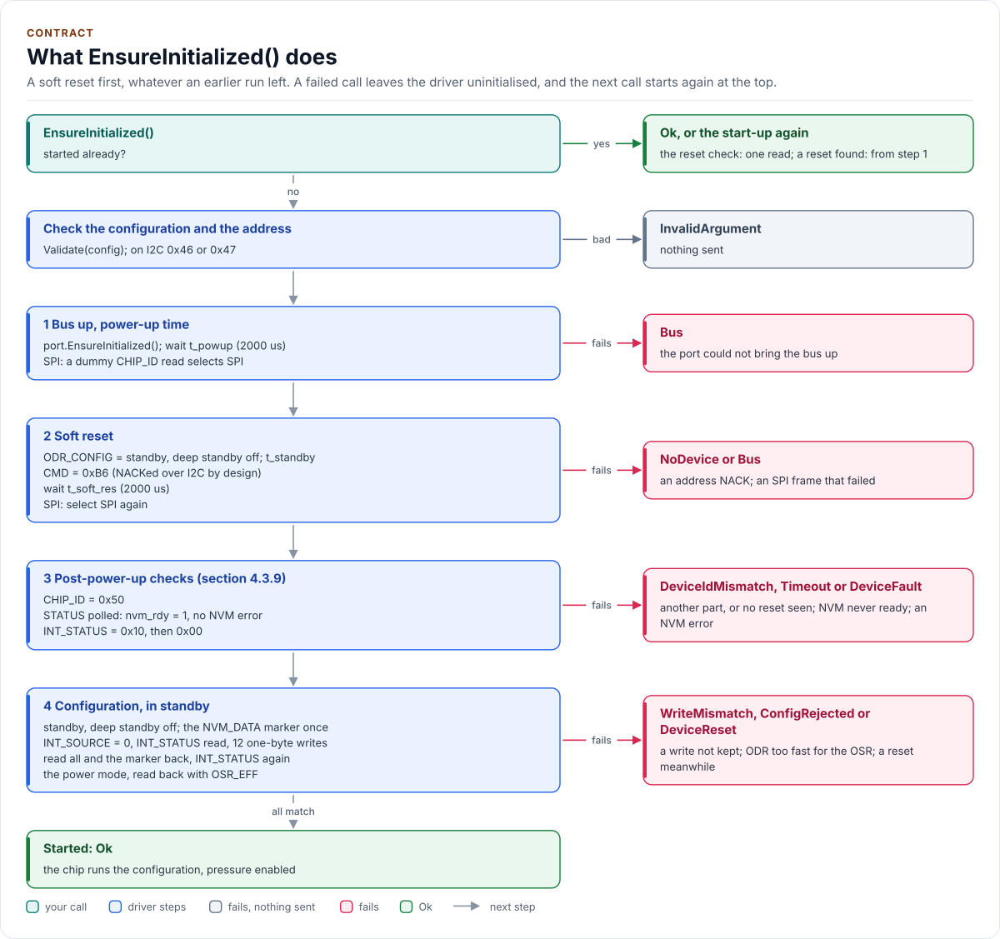

# Figures

<!-- Written by kokeb-docs figures from docs/diagrams/figures/*.py. Do not edit by hand. -->

Every figure on this site is drawn by a Python module from facts extracted from the code, so it is rebuilt,
not redrawn, when the code changes. CI runs `kokeb-docs figures --check` and fails when a
committed figure no longer matches the code. Each figure below lists the files it is drawn from.

## Inside the BMP581

<!-- figure: chip-blocks -->
<picture>
  <source media="(prefers-color-scheme: dark)" srcset="chip-blocks.dark.svg">
  
</picture>
<!-- /figure -->

Hardware description: [`docs/hardware.yml`](../hardware.yml)

Drawn from:

- [`docs/hardware.yml`](../hardware.yml)
- [`inc/bmp581_i2c_interface.hpp`](../../inc/bmp581_i2c_interface.hpp)
- [`inc/bmp581_spi_interface.hpp`](../../inc/bmp581_spi_interface.hpp)

## BMP581: I2C connection

<!-- figure: chip-circuit-i2c -->
<picture>
  <source media="(prefers-color-scheme: dark)" srcset="chip-circuit-i2c.dark.svg">
  
</picture>
<!-- /figure -->

Hardware description: [`docs/hardware.yml`](../hardware.yml)

Drawn from:

- [`docs/hardware.yml`](../hardware.yml)
- [`inc/bmp581_i2c_interface.hpp`](../../inc/bmp581_i2c_interface.hpp)
- [`inc/bmp581_spi_interface.hpp`](../../inc/bmp581_spi_interface.hpp)

## BMP581: SPI 4-wire connection

<!-- figure: chip-circuit-spi4 -->
<picture>
  <source media="(prefers-color-scheme: dark)" srcset="chip-circuit-spi4.dark.svg">
  
</picture>
<!-- /figure -->

Hardware description: [`docs/hardware.yml`](../hardware.yml)

Drawn from:

- [`docs/hardware.yml`](../hardware.yml)
- [`inc/bmp581_i2c_interface.hpp`](../../inc/bmp581_i2c_interface.hpp)
- [`inc/bmp581_spi_interface.hpp`](../../inc/bmp581_spi_interface.hpp)

## BMP581 pinout, LGA-10

<!-- figure: chip-pinout -->
<picture>
  <source media="(prefers-color-scheme: dark)" srcset="chip-pinout.dark.svg">
  
</picture>
<!-- /figure -->

Hardware description: [`docs/hardware.yml`](../hardware.yml)

Drawn from:

- [`docs/hardware.yml`](../hardware.yml)
- [`inc/bmp581_i2c_interface.hpp`](../../inc/bmp581_i2c_interface.hpp)
- [`inc/bmp581_spi_interface.hpp`](../../inc/bmp581_spi_interface.hpp)

## The layers, one of them yours

<!-- figure: driver-layers -->
<picture>
  <source media="(prefers-color-scheme: dark)" srcset="driver-layers.dark.svg">
  
</picture>
<!-- /figure -->

Figure module: [`docs/diagrams/figures/driver-layers.py`](../../docs/diagrams/figures/driver-layers.py)

Drawn from:

- `public calls` in [`inc/bmp581.hpp`](../../inc/bmp581.hpp)
- `I2cInterface` in [`inc/bmp581_i2c_interface.hpp`](../../inc/bmp581_i2c_interface.hpp)
- `SpiInterface` in [`inc/bmp581_spi_interface.hpp`](../../inc/bmp581_spi_interface.hpp)

## From a conversion to a value

<!-- figure: measurement -->
<picture>
  <source media="(prefers-color-scheme: dark)" srcset="measurement.dark.svg">
  
</picture>
<!-- /figure -->

Figure module: [`docs/diagrams/figures/measurement.py`](../../docs/diagrams/figures/measurement.py)

Drawn from:

- `MeasureOnce, waitForcedShown, WaitDataReady, readData, settle` in [`src/bmp581.ipp`](../../src/bmp581.ipp)
- `kDataReset` in [`inc/bmp581_registers.hpp`](../../inc/bmp581_registers.hpp)
- `kPressureMinPa, kPressureMaxPa, kTemperatureMinC, kTemperatureMaxC` in [`inc/bmp581_types.hpp`](../../inc/bmp581_types.hpp)

## What EnsureInitialized() does

<!-- figure: start-up -->
<picture>
  <source media="(prefers-color-scheme: dark)" srcset="start-up.dark.svg">
  
</picture>
<!-- /figure -->

Figure module: [`docs/diagrams/figures/start-up.py`](../../docs/diagrams/figures/start-up.py)

Drawn from:

- `EnsureInitialized, initialize, resetChip, identify, waitNvmReady, checkResetFlags, configure` in [`src/bmp581.ipp`](../../src/bmp581.ipp)
- `kChipIdValue, kIntStatusAfterReset, kCmdSoftReset` in [`inc/bmp581_registers.hpp`](../../inc/bmp581_registers.hpp)
- `kPowerUpUs, kSoftResetUs` in [`inc/bmp581_types.hpp`](../../inc/bmp581_types.hpp)
