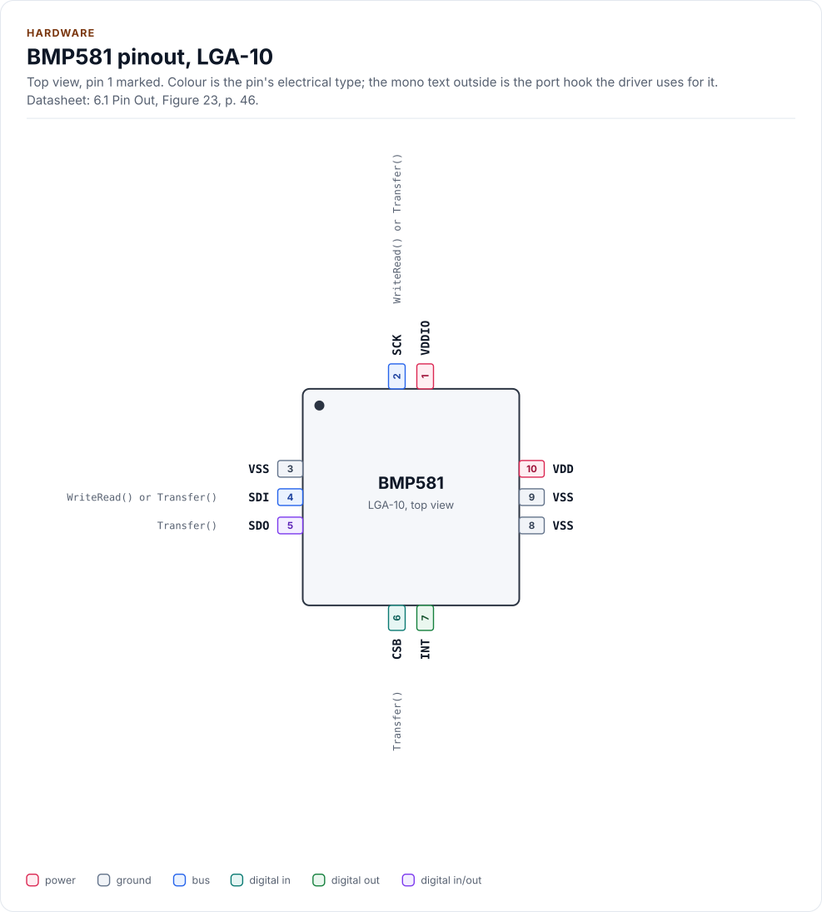
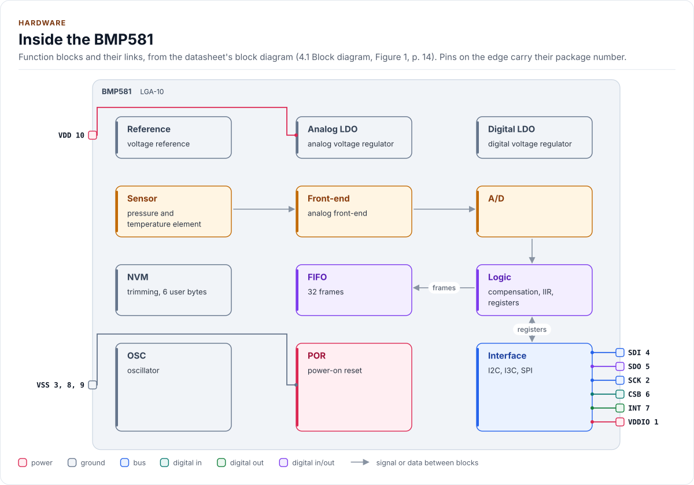
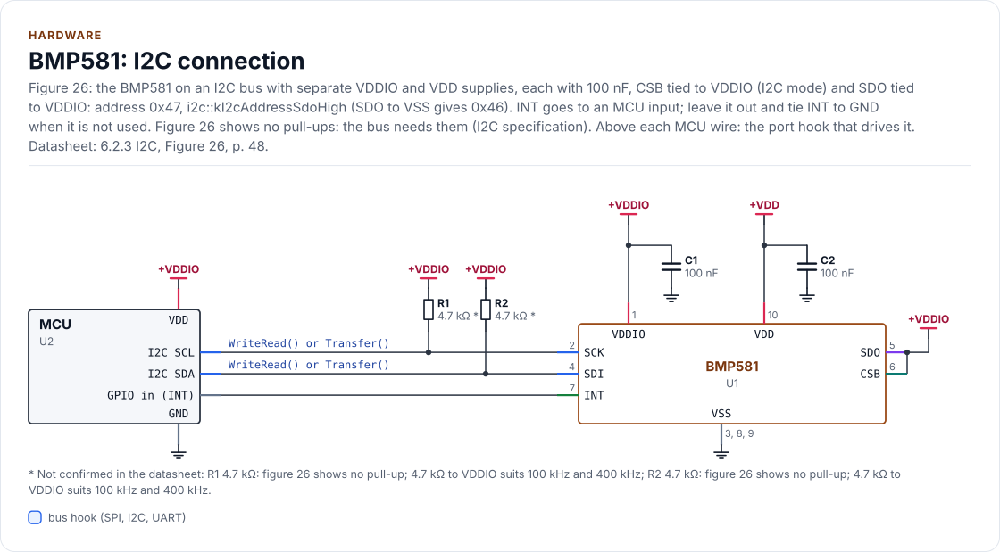
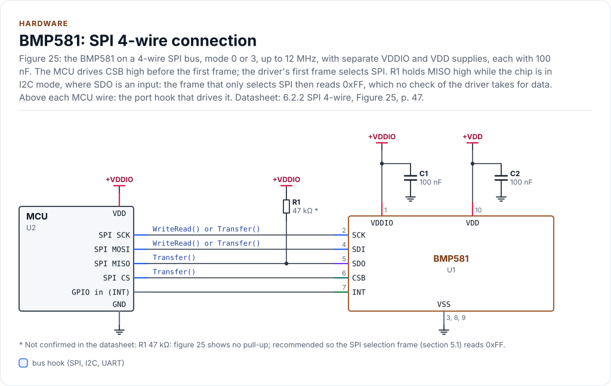

# Hardware

The BMP581's package, pins, connections, bus settings, timing and power, as the driver relies on them.

<!-- generated: datasheet-refs -->
??? abstract "Datasheet sections this page relies on"

    From Bosch Sensortec BST-BMP581-DS004-13 1.13:

    - Measurement range, resolution and accuracy: 2 Specification; Table 1 Pressure Performance; Table 2 Temperature Performance, [p. 8](https://www.bosch-sensortec.com/media/boschsensortec/downloads/datasheets/bst-bmp581-ds004.pdf#page=8)
    - Supplies, timing and conversion times: 2 Specification; Table 4 Electrical characteristics, [p. 10](https://www.bosch-sensortec.com/media/boschsensortec/downloads/datasheets/bst-bmp581-ds004.pdf#page=10)
    - Block diagram and power management: 4.1 Block diagram; 4.2 Power management, [p. 14](https://www.bosch-sensortec.com/media/boschsensortec/downloads/datasheets/bst-bmp581-ds004.pdf#page=14)
    - INT pin: 4.7.3 Interrupt pin, [p. 27](https://www.bosch-sensortec.com/media/boschsensortec/downloads/datasheets/bst-bmp581-ds004.pdf#page=27)
    - Interface selection (I2C, SPI): 5.1 Protocol Selection; Table 16, [p. 31](https://www.bosch-sensortec.com/media/boschsensortec/downloads/datasheets/bst-bmp581-ds004.pdf#page=31)
    - I2C protocol and addresses: 5.6 I2C protocol; 5.6.1 I2C write operation; 5.6.2 I2C read operation, [p. 38](https://www.bosch-sensortec.com/media/boschsensortec/downloads/datasheets/bst-bmp581-ds004.pdf#page=38)
    - Pins and connection diagrams: 6.1 Pin Out; 6.2 Connection Diagrams; Table 28, [p. 46](https://www.bosch-sensortec.com/media/boschsensortec/downloads/datasheets/bst-bmp581-ds004.pdf#page=46)

    All of them, with the driver API for each: [Datasheet map](datasheet.md).
<!-- /generated -->

## Package

A 10-pin metal-lid LGA, 2.0 mm x 2.0 mm, at most 0.8 mm high (table 3). The vent hole is on the lid; keep it open,
and keep vias, traces and solder mask out from under the part (section 8.2).

## Pins

Top view of figure 23. There is no reset or enable pin: CSB at power-up selects the interface, and the driver
resets the chip with a command.

<!-- figure: chip-pinout -->
<picture>
  <source media="(prefers-color-scheme: dark)" srcset="diagrams/chip-pinout.dark.svg">
  
</picture>
<!-- /figure -->

<!-- generated: chip-pins -->
LGA-10, 10 pins (6.1 Pin Out, Figure 23, [p. 46](https://www.bosch-sensortec.com/media/boschsensortec/downloads/datasheets/bst-bmp581-ds004.pdf#page=46)).

| Pin | Name | Type (domain) | Function | Driver hook | If unused | Datasheet |
| --- | --- | --- | --- | --- | --- | --- |
| 1 | `VDDIO` | power (VDDIO) | Digital interface supply, 1.08 V to 3.6 V; any order with VDD | - | - | 2, [p. 10](https://www.bosch-sensortec.com/media/boschsensortec/downloads/datasheets/bst-bmp581-ds004.pdf#page=10) |
| 2 | `SCK` | bus (VDDIO) | Serial clock: I2C SCL, or SPI SCK | `WriteRead() or Transfer()` | - | 6.1, [p. 46](https://www.bosch-sensortec.com/media/boschsensortec/downloads/datasheets/bst-bmp581-ds004.pdf#page=46) |
| 3 | `VSS` | ground | Ground | - | - | 6.1, [p. 46](https://www.bosch-sensortec.com/media/boschsensortec/downloads/datasheets/bst-bmp581-ds004.pdf#page=46) |
| 4 | `SDI` | bus (VDDIO) | Serial data: I2C SDA, or SPI MOSI (SDX); data in and out in 3-wire SPI | `WriteRead() or Transfer()` | - | 6.1, [p. 46](https://www.bosch-sensortec.com/media/boschsensortec/downloads/datasheets/bst-bmp581-ds004.pdf#page=46) |
| 5 | `SDO` | digital in/out (VDDIO) | SPI MISO; on I2C the address LSB: VSS 0x46, VDDIO 0x47 | `Transfer()` | I2C: tie to VSS or VDDIO, never open | 5.6, [p. 38](https://www.bosch-sensortec.com/media/boschsensortec/downloads/datasheets/bst-bmp581-ds004.pdf#page=38) |
| 6 | `CSB` | digital in (VDDIO) | SPI chip select, active low; held at VDDIO from power-up selects I2C | `Transfer()` | I2C: tie to VDDIO | 5.1, [p. 31](https://www.bosch-sensortec.com/media/boschsensortec/downloads/datasheets/bst-bmp581-ds004.pdf#page=31) |
| 7 | `INT` | digital out (VDDIO) | Interrupt output, push-pull or open drain, polarity set by INT_CONFIG | - | Tie to GND with INT_CONFIG.int_en = 0, the reset value | 4.7.3, [p. 27](https://www.bosch-sensortec.com/media/boschsensortec/downloads/datasheets/bst-bmp581-ds004.pdf#page=27) |
| 8 | `VSS` | ground | Ground | - | - | 6.1, [p. 46](https://www.bosch-sensortec.com/media/boschsensortec/downloads/datasheets/bst-bmp581-ds004.pdf#page=46) |
| 9 | `VSS` | ground | Ground | - | - | 6.1, [p. 46](https://www.bosch-sensortec.com/media/boschsensortec/downloads/datasheets/bst-bmp581-ds004.pdf#page=46) |
| 10 | `VDD` | power (VDD) | Analog supply, 1.71 V to 3.6 V; any order with VDDIO | - | - | 2, [p. 10](https://www.bosch-sensortec.com/media/boschsensortec/downloads/datasheets/bst-bmp581-ds004.pdf#page=10) |

Source of this table and of the chip figures: [`docs/hardware.yml`](hardware.yml).
<!-- /generated -->

Never hold SDI, SDO, SCK or CSB high while VDDIO is off: the current through the protection diodes can damage
the part (section 4.2).

## Blocks

<!-- figure: chip-blocks -->
<picture>
  <source media="(prefers-color-scheme: dark)" srcset="diagrams/chip-blocks.dark.svg">
  
</picture>
<!-- /figure -->

The chip compensates both values itself (section 4.1): the data registers and the FIFO hold pressure in pascals
and temperature in degrees Celsius as fixed-point numbers, and the driver only converts their scale.

## Interface selection

After a power-on or soft reset the interface is in I2C mode (section 5.1). With CSB tied to VDDIO it stays there.
The first CSB low phase with at least 16 SCK edges changes it to SPI until the next reset; that first frame
carries no valid data. The SPI port of the driver sends this dummy read itself, in `EnsureInitialized()` and again
after its soft reset, because a soft reset returns the interface to I2C (table 16). An I2C board must never pull
CSB low: the chip would leave I2C mode until the next power cycle.

## I2C

- Address `0x46` with SDO at VSS, `0x47` with SDO at VDDIO (section 5.6); SDO must not float.
- 100 kHz to 1 MHz (table 4): fast mode plus needs a bus capacitance under 100 pF.
- A register read is a write of the address, then a read; the chip keeps the address across a STOP, so a
  repeated START or a STOP and START both work (figures 15, 16). The driver calls `WriteRead()`.
- The soft reset (CMD = 0xB6) is not acknowledged (section 7.36); the driver expects the NACK and proves the reset
  by the reads that follow.

<!-- figure: chip-circuit-i2c -->
<picture>
  <source media="(prefers-color-scheme: dark)" srcset="diagrams/chip-circuit-i2c.dark.svg">
  
</picture>
<!-- /figure -->

<!-- generated: chip-parts -->
**I2C connection** (figure `chip-circuit-i2c`)

| Part | Kind | Value | Connects | Datasheet |
| --- | --- | --- | --- | --- |
| U2 | MCU | - | VDD: +VDDIO, GND: GND, SCL: SCL, SDA: SDA, INT: INT | 6.2.3, [p. 48](https://www.bosch-sensortec.com/media/boschsensortec/downloads/datasheets/bst-bmp581-ds004.pdf#page=48) |
| R1 | resistor | 4.7 kΩ (not confirmed: figure 26 shows no pull-up; 4.7 kΩ to VDDIO suits 100 kHz and 400 kHz) | +VDDIO, SCL | 6.2.3, [p. 48](https://www.bosch-sensortec.com/media/boschsensortec/downloads/datasheets/bst-bmp581-ds004.pdf#page=48) |
| R2 | resistor | 4.7 kΩ (not confirmed: figure 26 shows no pull-up; 4.7 kΩ to VDDIO suits 100 kHz and 400 kHz) | +VDDIO, SDA | 6.2.3, [p. 48](https://www.bosch-sensortec.com/media/boschsensortec/downloads/datasheets/bst-bmp581-ds004.pdf#page=48) |
| C1 | capacitor | 100 nF | +VDDIO, GND | 6.2.3, [p. 48](https://www.bosch-sensortec.com/media/boschsensortec/downloads/datasheets/bst-bmp581-ds004.pdf#page=48) |
| C2 | capacitor | 100 nF | +VDD, GND | 6.2.3, [p. 48](https://www.bosch-sensortec.com/media/boschsensortec/downloads/datasheets/bst-bmp581-ds004.pdf#page=48) |

**SPI 4-wire connection** (figure `chip-circuit-spi4`)

| Part | Kind | Value | Connects | Datasheet |
| --- | --- | --- | --- | --- |
| U2 | MCU | - | VDD: +VDDIO, GND: GND, SCK: SCK, MOSI: MOSI, MISO: MISO, CS: CSB, INT: INT | 6.2.2, [p. 47](https://www.bosch-sensortec.com/media/boschsensortec/downloads/datasheets/bst-bmp581-ds004.pdf#page=47) |
| R1 | resistor | 47 kΩ (not confirmed: figure 25 shows no pull-up; recommended so the SPI selection frame (section 5.1) reads 0xFF) | +VDDIO, MISO | 6.2.2, [p. 47](https://www.bosch-sensortec.com/media/boschsensortec/downloads/datasheets/bst-bmp581-ds004.pdf#page=47) |
| C1 | capacitor | 100 nF | +VDDIO, GND | 6.2.2, [p. 47](https://www.bosch-sensortec.com/media/boschsensortec/downloads/datasheets/bst-bmp581-ds004.pdf#page=47) |
| C2 | capacitor | 100 nF | +VDD, GND | 6.2.2, [p. 47](https://www.bosch-sensortec.com/media/boschsensortec/downloads/datasheets/bst-bmp581-ds004.pdf#page=47) |

Export a circuit for a schematic or PCB tool: `kokeb-docs hardware --kicad-netlist OUT.net --circuit i2c`.
<!-- /generated -->

## SPI

- Four-wire, mode 0 or 3, the mode chosen by SCK at the CSB falling edge (section 5.5); up to 12 MHz with VDDIO at
  or above 1.62 V, 7 MHz below (table 4).
- Bit 7 of the first byte is the read flag, bits 6 to 0 the address; read data starts at the second byte, with no
  dummy byte (figures 8 to 11).
- CSB stays high at least 80 ns between frames (table 18). After a write to INT_CONFIG the driver waits 1 µs
  before it reads it back (section 5.5.4); it never uses hybrid bursts.
- Three-wire SPI (DRIVE_CONFIG.spi3_en) is not supported: the driver never writes DRIVE_CONFIG.
- A pull-up on MISO (R1, 47 kΩ, not in figure 25) is recommended. After a reset the chip is back in I2C mode, where
  SDO is an input, and the first frame only selects SPI (section 5.1): MISO floats. With the pull-up the frame reads
  0xFF, which every check refuses; without it the driver still runs the reset check after each status read on SPI
  (see [Contract](contract.md#resets)).
- The circuit labels SCK and SDI with both hooks, `WriteRead() or Transfer()`: the diagram tool takes one hook per
  chip pin for every circuit, and these pins serve both buses. On this circuit they are `Transfer()`; on the I2C
  circuit, `WriteRead()` (and `Write()` for the writes).

<!-- figure: chip-circuit-spi4 -->
<picture>
  <source media="(prefers-color-scheme: dark)" srcset="diagrams/chip-circuit-spi4.dark.svg">
  
</picture>
<!-- /figure -->

## INT pin

Push-pull or open drain, active high or low, pulsed (105 µs typical) or latched (sections 4.7.3, table 4); the
driver writes `Config::int_*` to INT_CONFIG and the sources to INT_SOURCE. It never reads the pin: the
application may wire it to an interrupt and then call `ReadInterruptStatus()` or `ReadMeasurement()`. Unused: tie
INT to GND and leave `int_pin_enable` false, its reset value (section 6.2).

## Timing

| Step | Datasheet | Driver |
| --- | --- | --- |
| Power-up to first access | t_powup ≤ 2 ms (table 4) | `kPowerUpUs`, waited at every start |
| Soft reset | t_soft_res ≤ 2 ms | `kSoftResetUs` |
| Any mode to standby | t_standby ≤ 2.5 ms | `kStandbyUs`, then a read that confirms it |
| Standby to a measurement | t_startup ≤ 3 ms; from deep standby 4 ms | `ForcedMeasurementMaxUs()` |
| Conversion | t_conv_p + t_conv_t, ±5 % (table 4) | `ConversionTimeMaxUs()` |
| NVM ready after reset | not given | polled, at most `Config::startup_timeout_ms` |

## Power

| State | Current (typical, 25 °C) | How |
| --- | --- | --- |
| Deep standby | 0.55 µA | After `EnsureInitialized()` with `Config{}`, and after `Deinitialize()` |
| Standby | 1.0 µA | Standby with a FIFO, an IIR filter, a data rate of 5 Hz or more, or `deep_standby = false` |
| Normal, 1 Hz, low power | 1.3 µA | `LowPowerPreset()`: deep standby between the measurements (section 4.3.5) |
| High resolution, 30 Hz | 75 µA | `HighResolutionPreset()` (25 Hz) |

Deep standby needs all of: `deep_standby` true, a data rate under 5 Hz, the FIFO off and both IIR filters
bypassed (section 4.3.2); `EntersDeepStandby()` says whether a configuration meets them. The driver uses the
longer start-up time (4 ms) for a forced measurement from deep standby.

## Reference documents

The datasheet: [BMP581 datasheet][datasheet]. Every pin, setting and timing on this page cites a section of it;
its revision, its SHA-256 and the sections each page relies on are in [`docs/datasheets.yml`](datasheets.yml).

<!-- generated: datasheet-card -->
| Document | Revision | Get it |
| --- | --- | --- |
| Datasheet: BMP581 Barometric Pressure Sensor (Bosch Sensortec BST-BMP581-DS004-13) | 1.13, 2025-04 | [PDF](https://www.bosch-sensortec.com/media/boschsensortec/downloads/datasheets/bst-bmp581-ds004.pdf) · [vendor page](https://www.bosch-sensortec.com/products/environmental-sensors/pressure-sensors/bmp581/) |

Written against these revisions; the SHA-256 of each file is in [`docs/datasheets.yml`](datasheets.yml). Where each part
of the driver is in the datasheet: [Datasheet map](datasheet.md).
<!-- /generated -->

[datasheet]: https://www.bosch-sensortec.com/media/boschsensortec/downloads/datasheets/bst-bmp581-ds004.pdf
