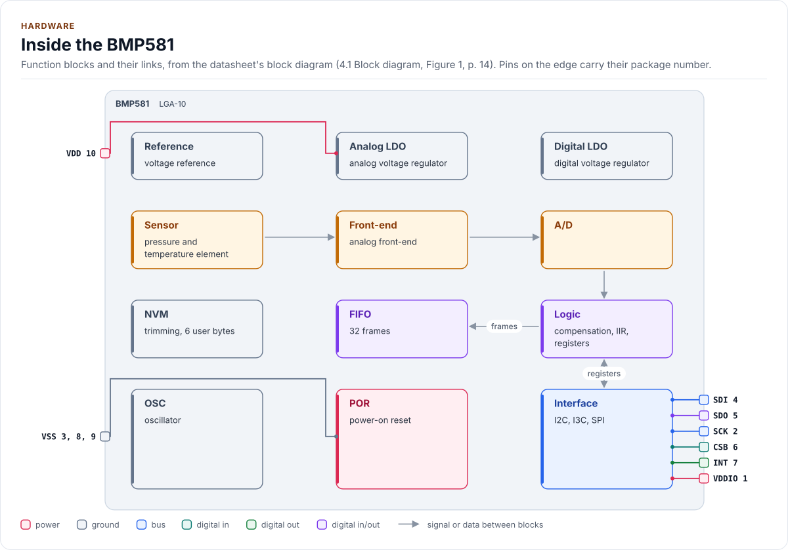
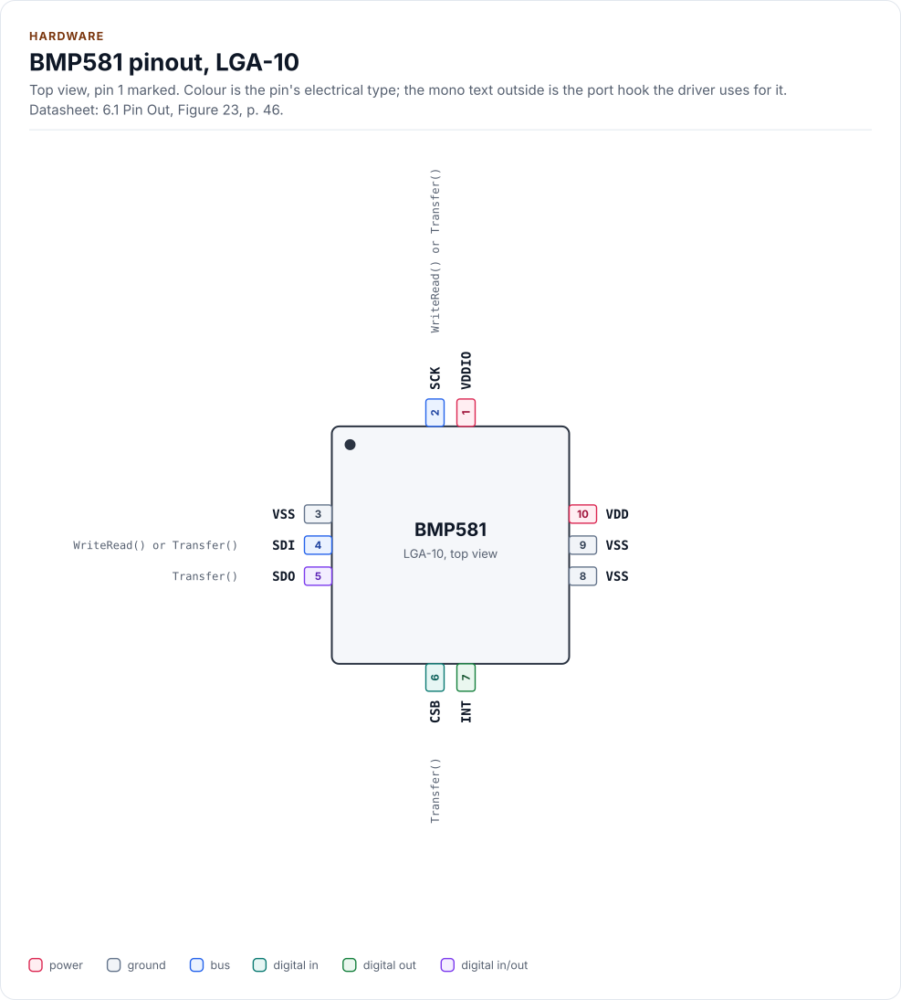
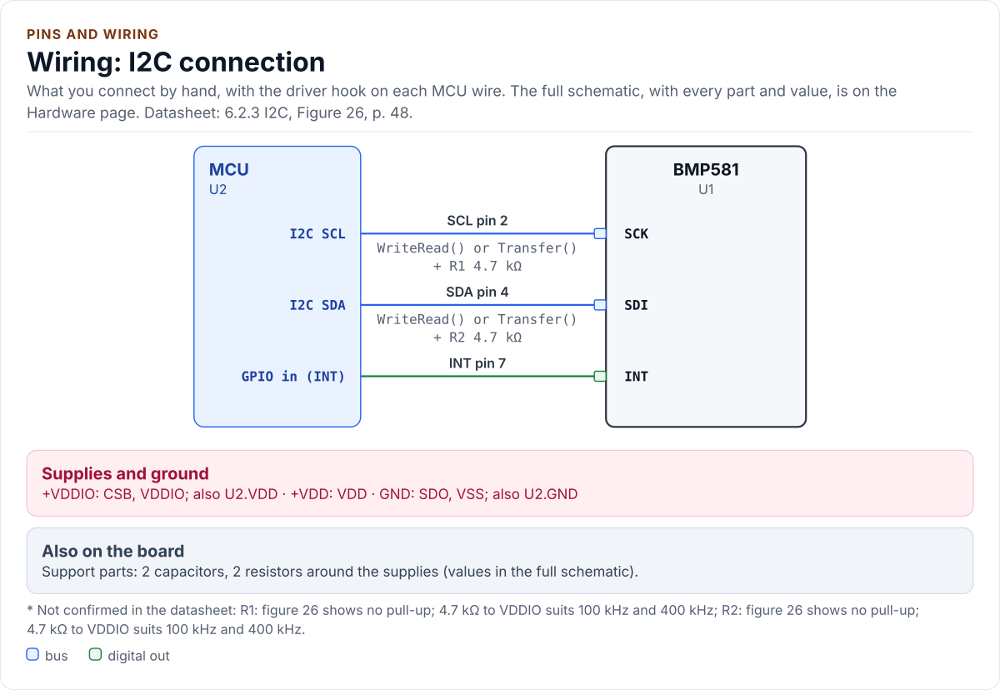

---
hide:
  - navigation
  - toc
---

<div class="kb-hero" markdown>
<span class="kb-kicker">Driver</span>

# BMP581 Driver

<p>A C++20 driver for the Bosch BMP581 barometric pressure and temperature sensor, on I2C or SPI. It starts the
chip from a soft reset, measures on request or continuously, reads the FIFO, and never returns a stuck line, a
reset value or an out-of-range reading as a measurement, on any MCU.</p>

[Quickstart](quickstart.md){ .md-button .md-button--primary }
[API guide](api-guide.md){ .md-button }
[Source on GitHub](https://github.com/kokeb-labs-drivers/driver-bmp581){ .md-button }
</div>

<!-- generated: chip-summary -->
The **BMP581** is an absolute barometric pressure sensor that measures pressure from 30 kPa to 125 kPa and temperature,
and linearises and compensates both on the chip (1 Basic Description, [p.
2](https://www.bosch-sensortec.com/media/boschsensortec/downloads/datasheets/bst-bmp581-ds004.pdf#page=2)).
<!-- /generated -->

<!-- figure: chip-hero -->
<picture>
  <source media="(prefers-color-scheme: dark)" srcset="diagrams/chip-hero.dark.svg">
  
</picture>
<!-- /figure -->

## What it does

<!-- figure: chip-capabilities -->
<picture>
  <source media="(prefers-color-scheme: dark)" srcset="diagrams/chip-capabilities.dark.svg">
  
</picture>
<!-- /figure -->

## Where it is used

<!-- generated: chip-uses -->
- GPS navigation enhancement and dead reckoning
- Indoor navigation, floor and elevator detection
- Outdoor navigation
- Sports and fitness activity tracking
- Emergency caller location
- Weather forecast
- Vertical speed indication
- Altitude control of drones and flying toys

Uses named by the datasheet (1 Basic Description, [p.
2](https://www.bosch-sensortec.com/media/boschsensortec/downloads/datasheets/bst-bmp581-ds004.pdf#page=2)).
<!-- /generated -->

## Inside the chip

<!-- figure: chip-blocks -->
<picture>
  <source media="(prefers-color-scheme: dark)" srcset="diagrams/chip-blocks.dark.svg">
  
</picture>
<!-- /figure -->

## Pins and wiring

<!-- figure: chip-pinout -->
<picture>
  <source media="(prefers-color-scheme: dark)" srcset="diagrams/chip-pinout.dark.svg">
  
</picture>
<!-- /figure -->

<!-- figure: chip-wiring-i2c -->
<picture>
  <source media="(prefers-color-scheme: dark)" srcset="diagrams/chip-wiring-i2c.dark.svg">
  
</picture>
<!-- /figure -->

<div class="kb-chip" markdown>
<div class="kb-chip__head">
<span class="kb-chip__kicker">Barometric pressure sensor</span>
<span class="kb-chip__name">BMP581</span>
<span class="kb-chip__vendor">Bosch Sensortec</span>
</div>

Function
:   Absolute pressure, 30 kPa to 125 kPa at 1/64 Pa per count; temperature, -40 °C to 85 °C at 1/65536 °C;
    compensated on the chip

Interface
:   I2C up to 1 MHz at `0x46` or `0x47` (SDO), or four-wire SPI up to 12 MHz, mode 0 or 3; I3C (not used here)

Modes
:   Standby and deep standby; forced (one measurement); normal at 0.125 Hz to 240 Hz; continuous

Data
:   Oversampling x1 to x128, an IIR filter, a 32-frame FIFO, interrupts for data ready, FIFO full and threshold,
    and pressure out of range

Supply
:   VDD 1.71 V to 3.6 V, VDDIO 1.08 V to 3.6 V; 1.3 µA at 1 Hz in low-power mode
</div>

Every pin, the reference circuits, the bus settings, the timing and the power: [Hardware](hardware.md).

## Quick start

Wire the chip as above, write the port for your MCU ([Porting](porting.md)), then:

<!-- generated: quickstart-code -->
```cpp
#include "bmp581.hpp"

int read_pressure(MyPort& port, float& pascals, float& celsius) {
  bmp581::BMP581<MyPort> sensor(port, bmp581::ForcedPreset()); // no I/O yet

  if (auto r = sensor.EnsureInitialized(); !r) { // 1. soft reset, CHIP_ID, NVM ready, Config
    return static_cast<int>(r.error); //    NoDevice, Bus or DeviceIdMismatch: check wiring
  }
  const auto m = sensor.MeasureOnce(); // 2. one forced measurement, then standby
  if (!m) {
    return static_cast<int>(m.error); //    every failure is an Error, never a number
  }
  pascals = bmp581::PressurePa(m.value.pressure_raw);      // 3. 1/64 Pa, exact
  celsius = bmp581::TemperatureC(m.value.temperature_raw); //    1/65536 °C, exact
  return 0;
}
```
<!-- /generated -->

Step by step, from a bare chip to the first result: [Quickstart](quickstart.md).

## Driver coverage

<!-- generated: chip-coverage -->
| Capability | What the chip does | Driver API | Registers | Status | Datasheet |
| --- | --- | --- | --- | --- | --- |
| [Pressure and temperature](api-guide.md) | Reads both compensated results in one burst, 1/64 Pa and 1/65536 °C per count | `ReadMeasurement`, `PressurePa`, `TemperatureC` | `PRESS_DATA_XLSB`, `PRESS_DATA_LSB`, `PRESS_DATA_MSB`, `TEMP_DATA_XLSB`, `TEMP_DATA_LSB`, `TEMP_DATA_MSB` | Supported | 4.5, [p. 22](https://www.bosch-sensortec.com/media/boschsensortec/downloads/datasheets/bst-bmp581-ds004.pdf#page=22) |
| [Power modes](api-guide.md) | One forced measurement on request, normal mode at a set rate, continuous, standby or deep standby | `MeasureOnce`, `SetPowerMode`, `PowerMode` | `ODR_CONFIG` | Supported | 4.3, [p. 16](https://www.bosch-sensortec.com/media/boschsensortec/downloads/datasheets/bst-bmp581-ds004.pdf#page=16) |
| [Oversampling and data rate](configuration.md) | Trades noise for current and speed, x1 to x128, with the rate checked against the chosen oversampling | `Oversampling`, `Validate`, `MaxOdrMilliHz`, `GetLastOsrEff` | `OSR_CONFIG`, `ODR_CONFIG`, `OSR_EFF` | Supported | 4.4.2, [p. 19](https://www.bosch-sensortec.com/media/boschsensortec/downloads/datasheets/bst-bmp581-ds004.pdf#page=19) |
| [IIR filter](configuration.md) | Low-pass filters pressure and temperature, for the data registers, the FIFO or the out-of-range check | `IirFilter`, `ApplyConfig` | `DSP_CONFIG`, `DSP_IIR` | Supported | 4.4.4, [p. 19](https://www.bosch-sensortec.com/media/boschsensortec/downloads/datasheets/bst-bmp581-ds004.pdf#page=19) |
| [FIFO](api-guide.md) | Buffers up to 32 frames, streaming or stop-on-full, with a threshold and decimation | `ReadFifo`, `ReadFifoCount`, `FifoFrame` | `FIFO_CONFIG`, `FIFO_COUNT`, `FIFO_SEL`, `FIFO_DATA` | Supported | 4.6, [p. 22](https://www.bosch-sensortec.com/media/boschsensortec/downloads/datasheets/bst-bmp581-ds004.pdf#page=22) |
| [Interrupts](configuration.md) | Data ready, FIFO full and FIFO threshold on the INT pin, push-pull or open drain | `ReadInterruptStatus`, `WaitDataReady`, `GetLatchedInterrupts` | `INT_CONFIG`, `INT_SOURCE`, `INT_STATUS` | Supported | 4.7, [p. 25](https://www.bosch-sensortec.com/media/boschsensortec/downloads/datasheets/bst-bmp581-ds004.pdf#page=25) |
| [Out-of-range detection](configuration.md) | Flags pressure that leaves a window around a reference for 1, 3, 7 or 15 samples in a row | `OorCount`, `kOorReferenceMaxPa`, `ReadInterruptStatus` | `OOR_THR_P_LSB`, `OOR_THR_P_MSB`, `OOR_RANGE`, `OOR_CONFIG` | Supported | 4.7.2.3, [p. 26](https://www.bosch-sensortec.com/media/boschsensortec/downloads/datasheets/bst-bmp581-ds004.pdf#page=26) |
| [Reset and identity](contract.md) | Soft reset, chip ID and NVM checks at start, and a power-on reset found mid-session | `EnsureInitialized`, `CheckForReset`, `GetRevision` | `CMD`, `CHIP_ID`, `REV_ID`, `STATUS` | Supported | 4.3.9, [p. 18](https://www.bosch-sensortec.com/media/boschsensortec/downloads/datasheets/bst-bmp581-ds004.pdf#page=18) |
| [NVM, I3C and 3-wire SPI](hardware.md) | Six user NVM bytes, the I3C bus and 3-wire SPI; the driver never programs the NVM | - | `NVM_ADDR`, `DRIVE_CONFIG` | Not covered | 4.8, [p. 29](https://www.bosch-sensortec.com/media/boschsensortec/downloads/datasheets/bst-bmp581-ds004.pdf#page=29) |

**Supported**: the driver covers it and a host test checks it; **Not covered**: the chip has it and the driver leaves it
alone.

From [`docs/hardware.yml`](hardware.yml); `kokeb-docs hardware --check` confirms that every API name is in
`inc/bmp581.hpp`, `inc/bmp581_types.hpp` and every register in `inc/bmp581_registers.hpp`.
<!-- /generated -->

The driver has no platform code. You give it a small class that brings the bus up and moves bytes; it does the
rest: the soft reset and the post-power-up checks, the configuration written in standby and read back, the
power modes, the data and FIFO reads, the conversion to pascals and degrees Celsius, and the reset check.

### What you get

- **One object per chip, on either bus.** `BMP581<YourPort>` takes a reference to an I2C or an SPI port and does
  no I/O until `EnsureInitialized()`. See [API guide](api-guide.md).
- **Values you can trust.** One 12-byte read per measurement, checked for stuck and floating lines, the reset
  value and the measurement range before a value is returned; FIFO frames carry their own validity. See
  [Contract](contract.md).
- **Resets found, never written over.** A brown-out mid-session is found by the next read or setter, confirmed
  by a second read, and reported as `DeviceReset`; nothing cached is written over the reset chip. See
  [Contract](contract.md#resets).
- **Datasheet defaults.** `Config{}` holds the chip's reset values with units in the field names, plus four
  presets; `Validate()` checks the ranges and the data rate table. See [Configuration](configuration.md).
- **Zero-overhead portability.** The port is a CRTP class checked by a concept: the bus hooks and a delay, plus
  optional failure and logging hooks found at compile time. See [Porting](porting.md).
- **No heap, no exceptions, no RTTI.** The host tests build with `-fno-exceptions -fno-rtti`. See
  [Contract](contract.md).
- **Tested without hardware.** Host tests and a fuzzer run the driver against a register model of the chip that
  measures, resets and fails on its own. See [Testing and CI](testing.md).

## Datasheet

<!-- generated: datasheet-card -->
| Document | Revision | Get it |
| --- | --- | --- |
| Datasheet: BMP581 Barometric Pressure Sensor (Bosch Sensortec BST-BMP581-DS004-13) | 1.13, 2025-04 | [PDF](https://www.bosch-sensortec.com/media/boschsensortec/downloads/datasheets/bst-bmp581-ds004.pdf) · [vendor page](https://www.bosch-sensortec.com/products/environmental-sensors/pressure-sensors/bmp581/) |

Written against these revisions; the SHA-256 of each file is in [`docs/datasheets.yml`](datasheets.yml). Where each part
of the driver is in the datasheet: [Datasheet map](datasheet.md).
<!-- /generated -->

## Where to go next

<div class="grid cards" markdown>

-   :material-rocket-launch-outline: **[Quickstart](quickstart.md)**

    ---

    Wire the chip, write the port, take a measurement in about 15 lines.

-   :material-chip: **[Hardware](hardware.md)**

    ---

    Pins, connection, bus settings, timing and power.

-   :material-file-document-check-outline: **[Contract](contract.md)**

    ---

    What the driver promises, what it needs, resets, threading and errors.

-   :material-code-braces: **[API guide](api-guide.md)**

    ---

    Initialise, measure, stream, read the FIFO and handle errors, task by task.

-   :material-swap-horizontal: **[Porting](porting.md)**

    ---

    Implement the I2C or SPI port for your MCU.

-   :material-book-open-variant: **[API reference](api-reference.md)**

    ---

    Every class and member, generated from the headers.

</div>
